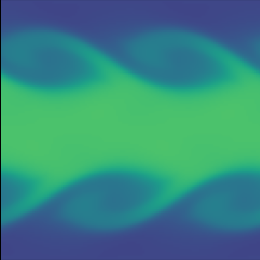

# Kelvin-Helmholtz

Kelvin-Helmholtz instability of an ideal gas (Euler equations)

Philip Mocz (2026)

Usage:

```console
python kelvin_helmholtz.py --res <resolution_multiplier>
```

Takes around 11 (res=1) seconds to run on my macbook (cpu).

Two counter-streaming layers of gas, seeded with a small velocity perturbation
at the two shearing interfaces, roll up into the characteristic Kelvin-Helmholtz
billows.
Gravity and the wavefunction are switched off, so the
`"ideal"` equation of state (with adiabatic index `gamma`) and the Courant
condition set by `sound_speed` are what drive the simulation.

The instability is under-resolved at the default resolution; use `--res 4` or
higher to see the billows roll up cleanly.


## Simulation snapshots

(run at `--res 4`)

<div style="display:flex;flex-wrap:wrap;gap:8px">
  
</div>


## References

[Springel, V.; E pur si muove: Galilean-invariant cosmological hydrodynamical simulations on a moving mesh. Monthly Notices of the Royal Astronomical Society (2020)](https://ui.adsabs.harvard.edu/abs/2010MNRAS.401..791S)
